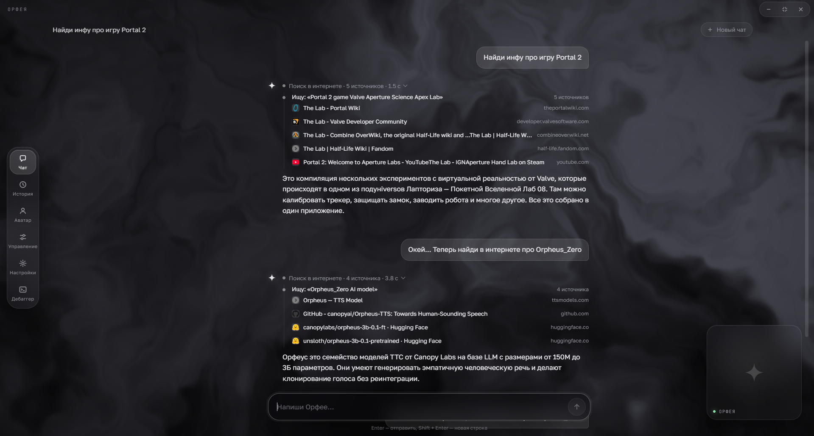
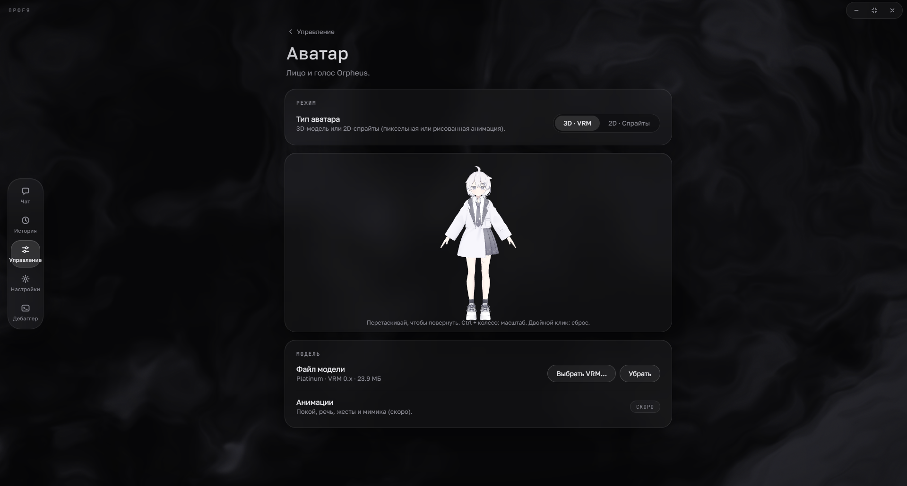
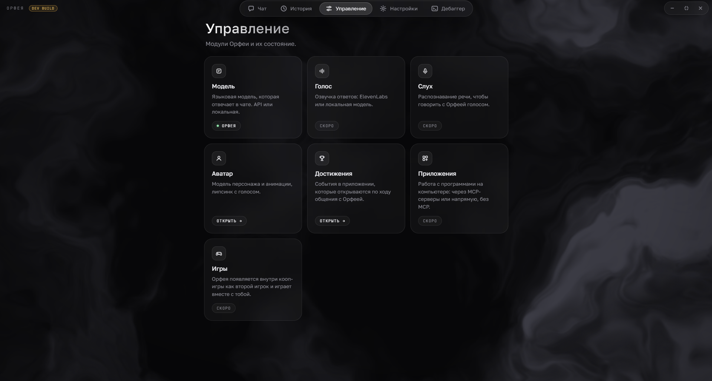
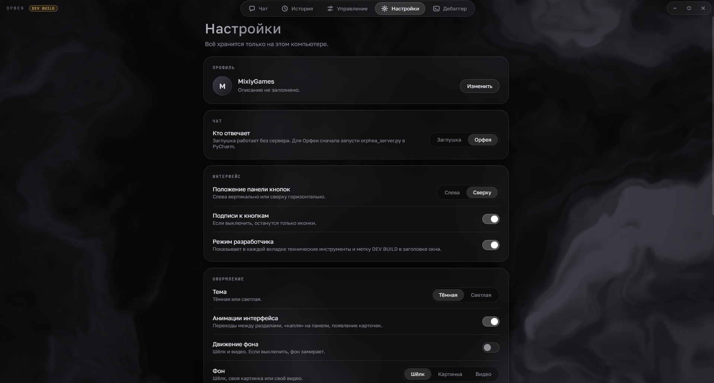

# Project Orpheus (mebius)

Что-то среднее между ИИ-приложением и игрой. С одной стороны, это чат с языковой моделью (как Claude Desktop, только со своим дизайном и своими идеями). С другой, у модели есть лицо и тело: 3D-аватар в чате, а потом ещё и Орфея, сможет жить на рабочем столе, бегать по экрану, прыгать и садится на края окон.

> Пока это ранняя стадия: чат, оформление и загрузка аватара уже работают, голос и питомец ещё в планах. Честный список ниже.

Внутри проект называется **mebius** (пакет, крейт, идентификатор), а в интерфейсе везде **Orpheus**. Так получилось исторически, потом, может, приведу к одному.

> Только Windows (WebView2), личный проект.

## Что уже работает

- **Чат** с потоковым выводом, остановкой генерации, историей и поиском по ней, копированием сообщений.
- **Два «мозга» на выбор**: заглушка, которая печатает ответ по буквам (работает без всего), или Орфея, моя локальная модель на Python, подключённая по WebSocket.
- **Поиск в интернете** у Орфеи: над ответом появляется сворачиваемая лента шагов с запросом и источниками.
- **Аватар**: загружаешь свой `.vrm` (0.x и 1.0), и он дышит, моргает и крутится мышкой. Для тех, кто любит ковыряться, есть панель настройки модели в режиме разработчика.
- **Оформление**: тёмная и светлая тема, панель кнопок слева или сверху, свой фон (шейдер «шёлк», картинка или видео), отключаемые анимации.
- **Дебаггер**: единый журнал приложения с фильтрами и режимом разработчика.
- **Достижения**: система уже есть, сами достижения пока заглушки.

Всё хранится локально (localStorage и IndexedDB), никуда не уезжает.

## Скриншоты

<!-- Положи картинки в папку docs/screenshots/ и поправь имена файлов ниже -->

| Чат | Аватар |
| --- | --- |
|  |  |

| Управление | Настройки и фон |
| --- | --- |
|  |  |

## Тихий уголок

В окне «Модель» есть вкладка, которая заперта. Говорят, у каждого сердца есть то, что оно держит под замком, и у Орфеи оно тоже есть.

Как до него добраться, я не скажу. Подсказок здесь нет, можно просто жить с ней, разговаривать, смотреть, как меняются её настроения, и однажды что-нибудь да заметишь. А может, и не заметишь.

Если заметишь, лучше не торопись. Тьма не любит спешки, а свет, говорят, любит тех, кто не отводит глаз.

*Власть принадлежит тому, кто дошёл. Дошёл ли ты?*

## Что планируется

Идём по порядку, сначала интерфейс, потом настоящие модели:

1. Реальные провайдеры LLM: облачные по API-ключу, OpenRouter, локальные модели.
2. 3D-аватар с анимациями и выражениями лица.
3. TTS (через API вроде ElevenLabs, потом локально через ONNX) и липсинк.
4. STT.
5. **Питомец на рабочем столе**: прозрачное окно поверх всех, которое можно таскать, сажать на окна и которое умеет ходить и прыгать само.
6. 2D-режим аватара на спрайтшитах.
7. Работа с программами на компьютере и игра в кооп-игры вторым игроком.

## Стек

- [Tauri 2](https://tauri.app/) + Rust
- Vite + TypeScript, без фреймворков
- Three.js и `@pixiv/three-vrm` для аватара
- Шрифты Golos Text и JetBrains Mono

## Запуск

Нужны [Node.js](https://nodejs.org/), [Rust](https://rustup.rs/) и зависимости Tauri для Windows ([инструкция](https://tauri.app/start/prerequisites/)).

```powershell
npm install
npm run tauri dev
```

Собрать:

```powershell
npm run tauri build
```

Приложение стартует с заглушкой вместо модели, так что для первого запуска больше ничего не нужно.

### Подключить Орфею

Орфея живёт в отдельном Python-проекте (FastAPI + WebSocket, адрес `ws://127.0.0.1:8765/chat`, только localhost). Когда сервер запущен, в приложении открой **Настройки → Чат** и выбери «Орфея». Если сервер недоступен, чат честно скажет об этом, а не зависнет.

## Как устроен код

```
src/
  main.ts          знакомство, окно, запуск
  chat.ts          чат
  shell.ts         разделы, панель кнопок, история, настройки
  llm.ts           интерфейс LLMProvider, заглушка, провайдер Орфеи
  avatar/          движок аватара (VRM, дыхание, моргание, настройки)
  achievements/    достижения
  background.ts    фон
  log.ts, debug.ts журнал и вкладка «Дебаггер»
src-tauri/         Rust-часть
```

Хотя бы одна идея, ради которой всё затевалось: аватар не знает, где он стоит (в окне или на рабочем столе), и управляется не координатами, а намерениями вроде «говорит», «радуется», «садится». Поэтому один и тот же движок потом переедет в окно питомца.

## Лицензия

[Apache 2.0](LICENSE)
